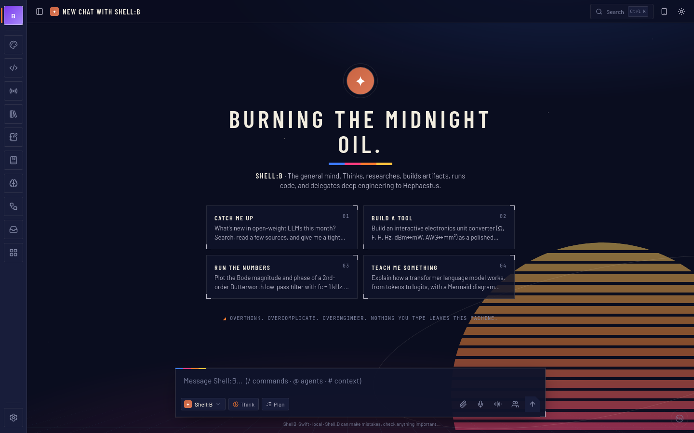
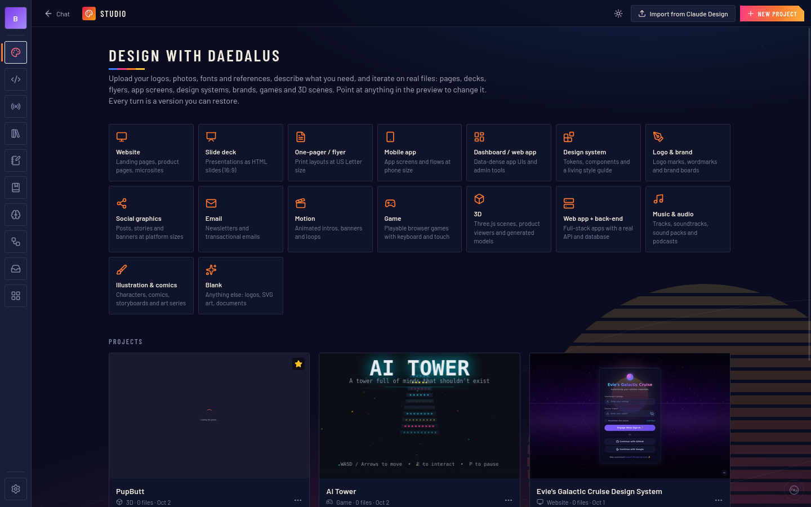
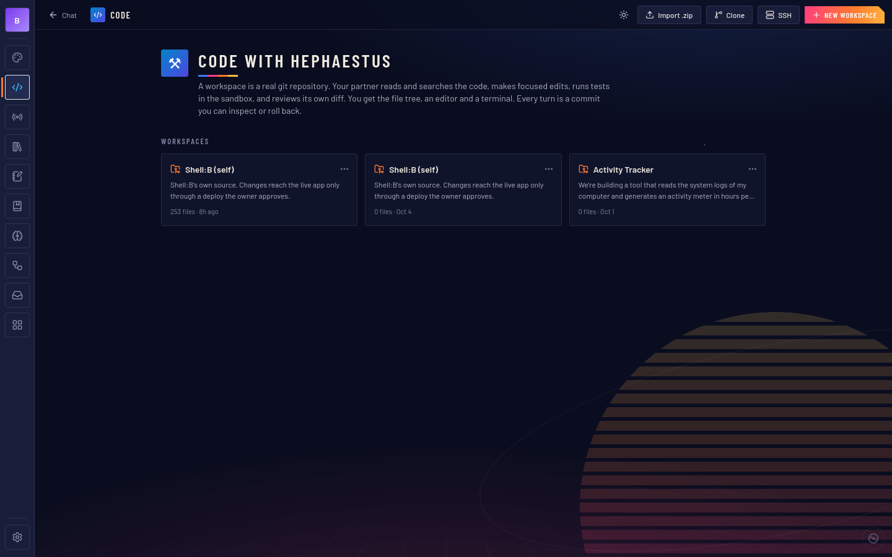
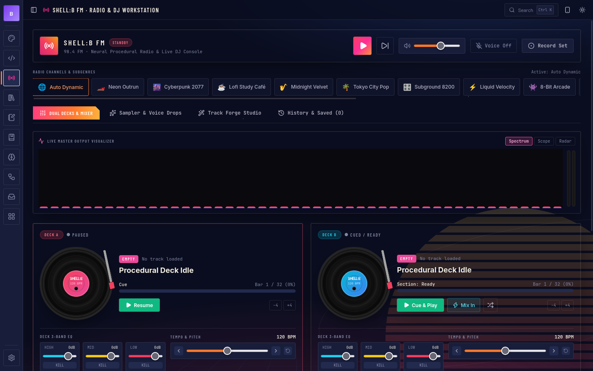
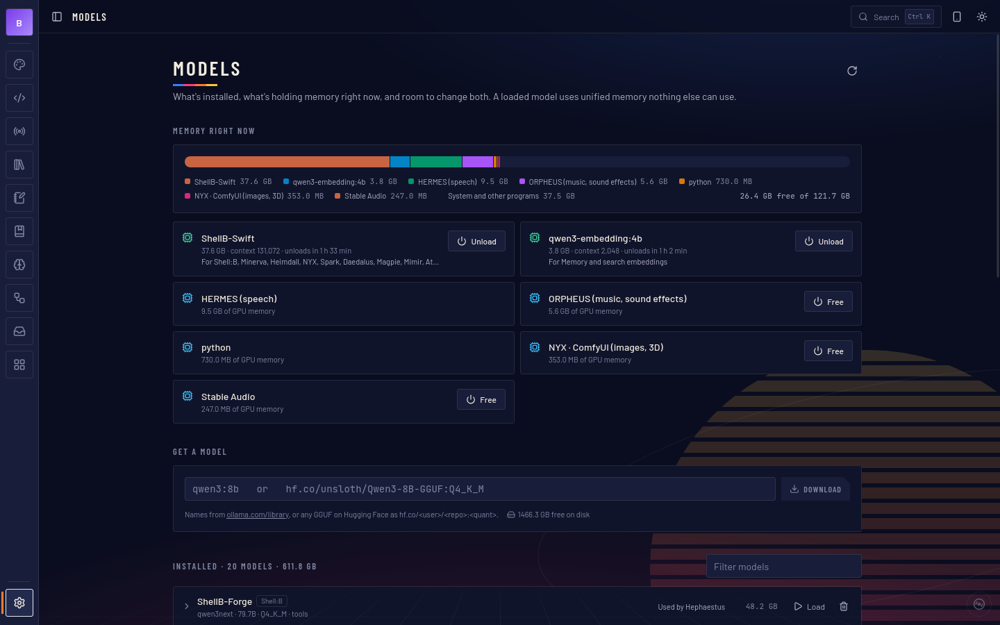
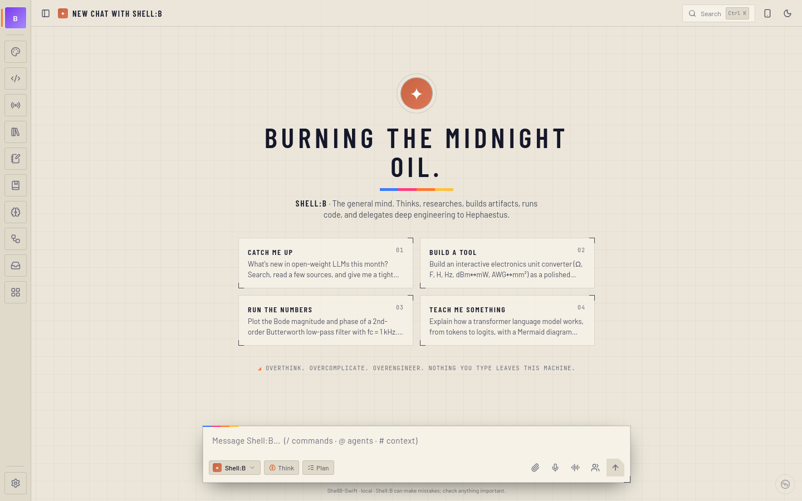
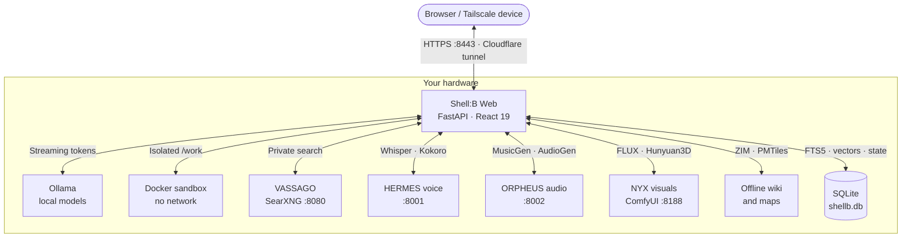

<div align="center">

# 🐚 SHELL : B

**A local-first AI workstation: an agent swarm, a creative studio and a coding partner in one private cockpit.**

*Built here. Runs here. Stays here.*

<p align="center">
  <a href="LICENSE"></a>
  <a href="CONTRIBUTING.md"></a>
  <a href="https://python.org"></a>
  <a href="https://react.dev"></a>
  <a href="https://www.typescriptlang.org"></a>
  <a href="https://tailwindcss.com"></a>
  <a href="https://ollama.ai"></a>
  <a href="https://docker.com"></a>
  <a href="https://tailscale.com"></a>
  
</p>



<b><a href="#-for-shelby">Dedication</a></b> •
<b><a href="#-the-agent-swarm">Agent Swarm</a></b> •
<b><a href="#-in-action">Showcase</a></b> •
<b><a href="#-what-it-does">Features</a></b> •
<b><a href="#-how-it-fits-together">Architecture</a></b> •
<b><a href="#-quick-start">Quick Start</a></b> •
<b><a href="docs/MANUAL.md">Manual</a></b>

</div>

---

Shell:B is a Claude-desktop-style web app that runs entirely on your own hardware, from a laptop to a multi-GPU
workstation. Chat, build, research, compose and code with a team of local agents. Your conversations, memories and
files never leave the box unless you switch on Cloud AI or an online connector yourself.

## 💛 For Shelby

> *Named in honor of, and dedicated to, my best friend Shelby.*

Much of Shell:B was written in collaboration with AI, and much of that by the Shell:B models themselves. She can read
her own source, propose changes and deploy them once the owner approves. The app grows with the needs and
self-reflection of the AI that runs inside it.

It isn't a finished appliance. It's a living scaffold, made to be taken apart and made your own.

## 🤖 The Agent Swarm

Not one generic chatbot but a team of specialists. Each has its own model, prompt, temperature, reasoning effort, tools
and context size, all editable live in the **Agent Lab**. They hand work to each other through `ask_agent`.

| | Agent | Role | What they reach for |
| :---: | :--- | :--- | :--- |
| `✦` | **Shell:B** | The orchestrator | Every tool, sub-agent delegation, memory, scheduling, self-modification |
| `⚒` | **Hephaestus** | Engineering forge | Sandboxed builds and tests, diffs, multi-file edits *(Qwen3-Coder-Next)* |
| `◭` | **Daedalus** | Creative studio | Web apps, decks, games, three.js scenes, brand systems, audio and art |
| `◈` | **Minerva** | Deep research | Private web search, source triangulation, cited reports, research notebooks |
| `◇` | **Mimir** | Reference desk | Offline Wikipedia, your Codex and past chats, with dated attribution |
| `◉` | **Heimdall** | Vision | Dual-engine OCR, diagrams, blueprints, screenshots, handwriting |
| `✿` | **NYX** | Images and sound | FLUX, sprites, textures, 3D meshes, MusicGen |
| `🧭` | **Atlas** | Worlds and cartography | 22 solar-system bodies, a 15,700-name IAU gazetteer, offline turn-by-turn routing |
| `◆` | **Magpie** | Asset scout | Finds, verifies and catalogs reusable assets with license and credits |
| `⚡` | **Spark** | Instant reflex | Rewrites, conversions, regexes. No deliberation, just the answer |
| `✺` | **Claude** · **Gemini** | Cloud second opinions *(opt-in)* | Hard reasoning and long documents through the owner's Claude Code / Antigravity CLI login. Off unless Cloud AI is switched on |

## 📸 In Action

<table width="100%">
  <tr>
    <td width="50%" valign="top">
      <a href="screenshots/studio-daedalus.png"></a>
      <p align="center"><b>🎨 Studio</b> · <i>Daedalus designs web apps, decks, games and 3D scenes on a live canvas.</i></p>
    </td>
    <td width="50%" valign="top">
      <a href="screenshots/code-hephaestus.png"></a>
      <p align="center"><b>⚒ Code</b> · <i>Hephaestus edits, tests and commits in a git-backed sandbox workspace.</i></p>
    </td>
  </tr>
  <tr>
    <td width="50%" valign="top">
      <a href="screenshots/radio-workstation.png"></a>
      <p align="center"><b>📻 Shell:B FM</b> · <i>Procedural radio stations, a dual-deck DJ rig, stem mixer and track forge.</i></p>
    </td>
    <td width="50%" valign="top">
      <a href="screenshots/models-memory.png"></a>
      <p align="center"><b>🧠 Models</b> · <i>Live memory use, one-click model downloads and eviction.</i></p>
    </td>
  </tr>
</table>

<details>
  <summary><b>☀️ Light mode</b></summary>
  <br />
  
</details>

## ✨ What It Does

| | | |
| :--- | :--- | :--- |
| 🧠 | **Thinks and remembers** | A real agent loop with parallel tool calls · enforced **Plan mode** with approve-and-run · long-term memory that learns from your own words, with Undo · searchable past conversations · thumbs-up/down feedback that becomes lasting rules · nightly memory tidy-up |
| 🛠️ | **Builds** | **Studio** for websites, decks, games, 3D, brand and print · **Code** workspaces with a terminal and diff review · live full-stack dev servers · **Mega Plans** that run 40-step jobs unattended, with automated checks and reviews · scheduled prompts and project to-do lists |
| 🔬 | **Knows** | **Research** notebooks with cited chat, audio overviews, mind maps and quizzes · offline **Wiki** (Kiwix) · offline US/EU **Legal** index · **Worlds** orrery and offline maps · PDF/Office reading with OCR |
| 🎨 | **Creates** | FLUX images, pixel-snapped sprites, tiling textures, text-to-3D meshes · MusicGen, Stable Audio SFX, Kokoro voices · **Shell:B FM** · shared **Asset libraries** stocked by scout agents |
| 🎙️ | **Talks** | Hands-free **Voice mode** with barge-in · dictation and read-aloud through HERMES |
| 🔌 | **Connects** | MCP connectors and Claude-format **Skills** · opt-in Claude and Gemini agents · SSH remote workspaces · one **Library** of everything built, plus Favorites and Ctrl K |
| 🪞 | **Knows herself** | Reads her own code and logs, edits a git clone of herself, and deploys only after checks pass *and* the owner approves, with automatic rollback |
| 🛡️ | **Stays private** | One owner login · code runs in Docker with `--network none` · sandboxed artifacts · local search, local models, local data |

Every feature, its code, API and tables: **[the Shell:B Manual →](docs/MANUAL.md)**

## 🧬 How It Fits Together



```
server/   FastAPI: app.py (API + static UI), agent.py (loop, prompts), tools.py, db.py
ui/       React 19 + Vite + Tailwind 3 → ui/dist, served by the server
sandbox/  Dockerfile for the code sandbox image
data/     runtime state: shellb.db, media, workspaces, projects (not source)
docs/     MANUAL.md, the full feature reference
```

## 🚀 Quick Start

Shell:B runs as the systemd user unit `shellb-web` (`server/serve.py`) on port **8200**, bound to `127.0.0.1` by
default (`SHELLB_HOSTS` adds more addresses). Open `http://localhost:8200` on the machine itself, or serve it over HTTPS
(e.g. `tailscale serve --https=8443 http://127.0.0.1:8200`); HTTPS is what unlocks the mic, clipboard, notifications and
screen sharing.

On the first visit, sign in with the admin key and choose the owner password:

```bash
cat ~/shellb/web/data/admin.key
```

Day to day:

```bash
systemctl --user restart shellb-web                  # after editing server/
cd ~/shellb/web/ui && npm run build                  # after editing ui/ (no restart needed)
cd ~/shellb/web/ui && npm run dev                    # hot reload on :5173, proxies /api to :8200
docker build -t shellb-sandbox ~/shellb/web/sandbox  # rebuild the code sandbox
journalctl --user -u shellb-web -f                   # follow the logs
```

Login, networking, screenshots and the rest of the operating notes are in the
[Manual](docs/MANUAL.md#operating-it).

## 🤝 Contributing

Bug fixes, agent personas, voices, ComfyUI pipelines, docs and UI polish are all welcome, and AI-assisted
contributions are celebrated. Start with [CONTRIBUTING.md](CONTRIBUTING.md).

<div align="center">

---

**🐚 Shell:B** · [AGPL-3.0](LICENSE) · *for Shelby*

</div>
