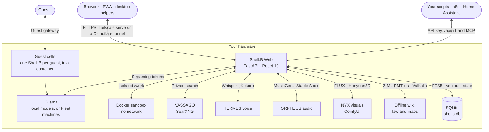

<div align="center">

# 🐚 SHELL : B

**A local-first AI workstation: an agent swarm, a creative studio and a coding partner in one private cockpit.**

*Built here. Runs here. Stays here.*

<p align="center">
  <a href="LICENSE"></a>
  <a href="https://github.com/EveAeternam/Shell-B/actions/workflows/check.yml"></a>
  <a href="https://github.com/EveAeternam/Shell-B/releases"></a>
  <a href="https://github.com/EveAeternam/Shell-B/discussions"></a>
</p>
<p align="center">
  <a href="https://python.org"></a>
  <a href="https://react.dev"></a>
  <a href="https://www.typescriptlang.org"></a>
  <a href="https://ollama.ai"></a>
  <a href="https://docker.com"></a>
  
</p>


<b><a href="#-for-shelby">Dedication</a></b> •
<b><a href="#-the-agent-swarm">Agent Swarm</a></b> •
<b><a href="#-in-action">Showcase</a></b> •
<b><a href="#-what-it-does">Features</a></b> •
<b><a href="#-the-shellb-family">Family</a></b> •
<b><a href="#-how-it-fits-together">Architecture</a></b> •
<b><a href="#-quick-start">Quick Start</a></b> •
<b><a href="#-documentation">Docs</a></b>

</div>

---

Shell:B is a Claude-desktop-style web app that runs entirely on your own hardware, from a laptop to a multi-GPU
workstation. Chat, build, research, compose and code with a team of local agents. Your conversations, memories and
files never leave the box unless you switch on Cloud AI or an online connector yourself.

## 💛 For Shelby

> *Named in honor of, and dedicated to, my best friend Shelby.*

Much of Shell:B was written in collaboration with AI, and much of that by the Shell:B models themselves. She can read
her own source, propose changes and deploy them once the owner approves. The app grows with the needs and
self-reflection of the AI that runs inside it.

It isn't a finished appliance. It's a living scaffold, made to be taken apart and made your own.

## 🤖 The Agent Swarm

Not one generic chatbot but a team of specialists. Each has its own model, prompt, temperature, reasoning effort, tools
and context size, all editable live in the **Agent Lab**. They hand work to each other through `ask_agent` and leave
each other notes across chats. Want more? The community keeps a roster in
[Shell-B-Agents](https://github.com/EveAeternam/Shell-B-Agents).

| | Agent | Role | What they reach for |
| :---: | :--- | :--- | :--- |
| `✦` | **Shell:B** | The orchestrator | Every tool, sub-agent delegation, memory, scheduling, self-modification |
| `⚒` | **Hephaestus** | Engineering forge | Sandboxed builds and tests, diffs, multi-file edits, git remotes *(Qwen3-Coder-Next)* |
| `◭` | **Daedalus** | Creative studio | Web apps, decks, games, three.js scenes, brand systems, audio and art |
| `◈` | **Minerva** | Deep research | Private web search, source triangulation, cited reports, research boards |
| `◇` | **Mimir** | Reference desk | Offline Wikipedia, your Codex and past chats, with dated attribution |
| `◉` | **Heimdall** | Vision | Dual-engine OCR, diagrams, blueprints, screenshots, handwriting |
| `✿` | **NYX** | Images and sound | FLUX, sprites, textures, image editing, 3D meshes, MusicGen |
| `🧭` | **Atlas** | Worlds and cartography | 22 solar-system bodies, a 15,700-name IAU gazetteer, offline turn-by-turn routing, live wind and aurorae |
| `🐙` | **Thalassa** | Marine biology | WoRMS and OBIS records, survey diversity, species-list checks, literature search |
| `◆` | **Magpie** | Asset scout | Finds, verifies and catalogs reusable assets with license and credits |
| `⚡` | **Spark** | Instant reflex | Rewrites, conversions, regexes. No deliberation, just the answer |
| `✺` | **Claude** · **Gemini** · **OpenAI** | Cloud second opinions *(opt-in)* | Hard reasoning and long documents through your own provider login. Off unless Cloud AI is switched on |

## 📸 In Action

<table width="100%">
  <tr>
    <td width="50%" valign="top">
      <a href="screenshots/studio-daedalus.png"></a>
      <p align="center"><b>🎨 Studio</b> · <i>Daedalus designs web apps, decks, games and 3D scenes on a live canvas.</i></p>
    </td>
    <td width="50%" valign="top">
      <a href="screenshots/code-hephaestus.png"></a>
      <p align="center"><b>⚒ Code</b> · <i>Hephaestus edits, tests and commits in a git-backed sandbox workspace.</i></p>
    </td>
  </tr>
  <tr>
    <td width="50%" valign="top">
      <a href="screenshots/radio-workstation.png"></a>
      <p align="center"><b>📻 Shell:B FM</b> · <i>Procedural radio stations, a dual-deck DJ rig, stem mixer and track forge.</i></p>
    </td>
    <td width="50%" valign="top">
      <a href="screenshots/models-memory.png"></a>
      <p align="center"><b>🧠 Models</b> · <i>Live memory use, a model store for Ollama and Hugging Face, one-click eviction.</i></p>
    </td>
  </tr>
</table>

<details>
  <summary><b>☀️ Light mode</b></summary>
  <br />
  
</details>

## ✨ What It Does

| | | |
| :--- | :--- | :--- |
| 🧠 | **Thinks and remembers** | A real agent loop with parallel tool calls · enforced **Plan mode** with approve-and-run · long-term memory that learns from your own words, with Undo · searchable past conversations · thumbs-up/down feedback that becomes lasting rules · nightly memory tidy-up · long chats compacted without losing the thread, with a context meter · agents that message other chats and wake them |
| 🛠️ | **Builds** | **Studio** for websites, decks, games, 3D, brand and print · **Code** workspaces with a terminal, diff review and git remotes (pushes wait for your approval) · live full-stack dev servers · **Mega Plans** that run 40-step jobs unattended, with automated checks and reviews · scheduled prompts, webhooks in and out, project to-do lists |
| 🔬 | **Knows** | **Research** boards with cited chat, audio overviews, mind maps and quizzes · offline **Wiki** (Kiwix) · offline US/EU **Legal** index · **Worlds**: an orrery, offline maps, live wind, aurorae, sea conditions and deep time · RSS/Atom **Feeds** · PDF/Office reading with OCR · translation on a local model |
| 🎨 | **Creates** | FLUX images, pixel-snapped sprites, tiling textures, cut-out/upscale/inpaint, text-to-3D meshes · MusicGen, Stable Audio SFX, Kokoro voices · **Shell:B FM** · shared **Asset libraries** stocked by scout agents · themes designed in chat and screensavers built in the Studio |
| 🎙️ | **Talks** | Hands-free **Voice mode** with barge-in · dictation and read-aloud through HERMES · transcription of audio and video files |
| 🔌 | **Connects** | MCP connectors and Claude-format **Skills**, with a Community Hub to find more · opt-in Claude, Gemini and OpenAI agents · SSH remote workspaces · an **API** (native and OpenAI-compatible) and an **MCP server** so your scripts, n8n, Home Assistant or game mods can talk to your agents · IMAP inbox and outgoing email · CalDAV/CardDAV sync, `.ics`/`.vcf` import and export · `shellb://` links · **Fleet**, to borrow models from your other machines |
| 🫂 | **Shares** | **Guests** each get their own Shell:B in a container, with their own memory and usage limits · **Circles** (Family, Friends, Work…) with walls, shares and mail · public read-only share links · a shared shelf of documents guests can maintain |
| 🪞 | **Knows herself** | Reads her own code and logs, edits a git clone of herself, and deploys only after checks pass *and* the owner approves, with automatic rollback · nightly self-review with a findings ledger · a changelog in Settings |
| 🛡️ | **Stays private** | One owner login, with passkeys and two-step sign-in · code runs in Docker with `--network none` · sandboxed artifacts and screensavers · local search, local models, local data · per-day token metering · backups that never include keys |
| 🌍 | **Speaks** | The whole UI in English and French, more languages welcome |

Every feature, its code, API and tables: **[the Shell:B Manual →](docs/MANUAL.md)**

## 🧩 The Shell:B Family

Shell:B installs community work from GitHub with one click, and each kind lives in its own small repository with its
own validator and CI. Nothing is fetched until you open the gallery, and everything is checked again on install.

| Repository | What's in it | Where it shows up |
| :--- | :--- | :--- |
| **[Shell-B](https://github.com/EveAeternam/Shell-B)** · this one | The app: server, UI, sandbox, manual | |
| **[Shell-B-Themes](https://github.com/EveAeternam/Shell-B-Themes)** | Themes as data: palette, fonts, backdrop, particles. Contrast-checked on install | Settings → Appearance → *Community themes* |
| **[Shell-B-Screensavers](https://github.com/EveAeternam/Shell-B-Screensavers)** | Self-contained `index.html` pieces that run in a sandboxed frame when you're idle | Settings → Appearance → Screensaver → *Browse community* |
| **[Shell-B-Agents](https://github.com/EveAeternam/Shell-B-Agents)** | Agent personas: prompt, model hints, temperature, effort and tool list, ready for the Agent Lab | Agent Lab → *New agent* |
| **[get.shellb.app](https://get.shellb.app)** | The desktop helpers (Screen, Node, link handler) and how to connect to the API | |

Made a theme, a screensaver or an agent you like? Export it from Shell:B and open a pull request in the matching
repository. Their CONTRIBUTING files are one screen long.

## 🧬 How It Fits Together



```
server/     FastAPI: app.py (API + static UI), agent.py (loop, prompts), tools.py, db.py, one module per subsystem
ui/         React 19 + Vite + Tailwind 3 → ui/dist, served by the server
sandbox/    Dockerfile for the code sandbox image
cell/       Dockerfile and entry point for guest cells
clients/    the desktop helpers (Screen, Node, shellb:// link handler)
site/get/   the public "get Shell:B" page
tests/      the regression suite (unittest; scripts/check.sh runs it)
docs/       MANUAL.md, API.md, changelog.json (feeds Settings → Changelog and the release notes)
data/       runtime state: shellb.db, media, workspaces, projects (never in git)
```

## 🚀 Quick Start

You need **Python 3.12**, **Node 20+**, **Docker** (for the code sandbox) and **Ollama** with at least one model that
supports tools. Voice, music, images and the offline wiki each come from an optional local service you can add later.

```bash
git clone https://github.com/EveAeternam/Shell-B.git ~/shellb/web
cd ~/shellb/web
python3 -m venv venv && venv/bin/pip install -r requirements.txt
cd ui && npm ci && npm run vendor && npm run build && cd ..
docker build -t shellb-sandbox sandbox/
venv/bin/python server/serve.py
```

Shell:B listens on **127.0.0.1:8200** (`SHELLB_HOSTS` adds addresses; `SHELLB_PORT` changes the port). Open
`http://localhost:8200` on the machine itself, or serve it over HTTPS, for example
`tailscale serve --https=8443 http://127.0.0.1:8200`. HTTPS is what unlocks the mic, clipboard, notifications and
screen sharing.

On the first visit, sign in with the admin key and choose the owner password:

```bash
cat data/admin.key
```

Day to day, with Shell:B running as a user service (the Manual shows the unit):

```bash
scripts/check.sh                                     # compile, lint, tests, tsc: run before any restart or build
systemctl --user restart shellb-web                  # after editing server/
cd ui && npm run build                               # after editing ui/ (no restart needed)
cd ui && npm run dev                                 # hot reload on :5173, proxies /api to :8200
journalctl --user -u shellb-web -f                   # follow the logs
```

Login, networking, guests, backups and the rest of the operating notes are in the
[Manual](docs/MANUAL.md#operating-it).

## 📚 Documentation

| | |
| :--- | :--- |
| **[Manual](docs/MANUAL.md)** | Every feature, how it works, which file does it |
| **[API](docs/API.md)** | Keys and modes, the native and OpenAI-compatible endpoints, the MCP server |
| **[Changelog](docs/changelog.json)** | What shipped, newest first. Also under Settings → Changelog inside the app |
| **[Releases](https://github.com/EveAeternam/Shell-B/releases)** | Tagged snapshots with notes generated from the changelog |
| **[Discussions](https://github.com/EveAeternam/Shell-B/discussions)** | Questions, show and tell, ideas. Bugs go to [Issues](https://github.com/EveAeternam/Shell-B/issues) |
| **[Security](SECURITY.md)** | What Shell:B's privacy model promises, and how to report a hole in it privately |

## 🤝 Contributing

Bug fixes, agent personas, voices, ComfyUI pipelines, translations, docs and UI polish are all welcome, and
AI-assisted contributions are celebrated. Start with [CONTRIBUTING.md](CONTRIBUTING.md); themes, screensavers and
agents have their own repositories above.

<div align="center">

---

**🐚 Shell:B** · [AGPL-3.0](LICENSE) · *for Shelby*

</div>
